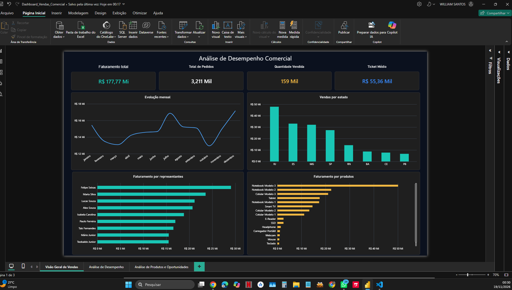
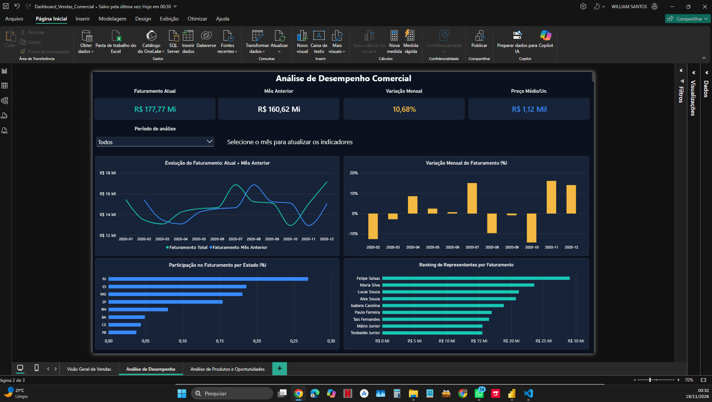
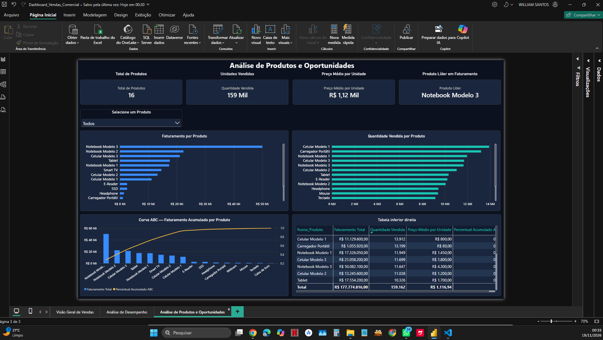

# Dashboard de Vendas e Análise Comercial | Power BI

## Sobre o projeto

Projeto de Business Intelligence desenvolvido no Power BI com o objetivo de transformar dados de vendas em informações estratégicas para apoiar a tomada de decisões comerciais.

O dashboard permite acompanhar indicadores de faturamento, analisar o desempenho comercial e identificar produtos com maior participação nas vendas.

## Tecnologias utilizadas

- Power BI Desktop
- Power Query — tratamento e transformação dos dados
- DAX — criação de medidas e indicadores
- Modelagem de dados
- Microsoft Excel — fonte de dados

## Indicadores analisados

- Faturamento total
- Quantidade de unidades vendidas
- Preço médio por unidade
- Total de produtos
- Produto líder em faturamento
- Participação acumulada no faturamento

## Páginas do dashboard

### 1. Visão Geral de Vendas

Apresentação dos principais indicadores comerciais, permitindo uma visão consolidada dos resultados.

### 2. Análise de Desempenho Comercial

Análise comparativa do desempenho das vendas, permitindo identificar tendências e diferenças entre segmentos comerciais.

### 3. Análise de Produtos e Oportunidades

Análise detalhada do desempenho dos produtos, incluindo:

- Faturamento por produto
- Quantidade vendida por produto
- Curva ABC e faturamento acumulado
- Tabela comparativa de indicadores por produto

## Funcionalidades

- Filtros interativos
- Indicadores calculados com DAX
- Visualizações dinâmicas
- Análise de participação acumulada
- Comparação de desempenho entre produtos

## Visualização do Dashboard

### Página 1 — Visão Geral de Vendas

### Página 2 — Análise de Desempenho Comercial

### Página 3 — Análise de Produtos e Oportunidades

## Como visualizar

1. Instale o Power BI Desktop.
2. Baixe o arquivo `Dashboard_Vendas_Comercial.pbix`.
3. Abra o arquivo no Power BI Desktop.
4. Explore as páginas e os filtros interativos.

**Observação:** para atualizar os dados, pode ser necessário configurar novamente o caminho da planilha Excel.

## Objetivo profissional

Este projeto faz parte de um portfólio voltado à área de Análise de Dados e Business Intelligence, demonstrando competências em tratamento de dados, modelagem, construção de indicadores e desenvolvimento de dashboards.

## Autor

**William de Jesus Santos**

Graduado em Análise e Desenvolvimento de Sistemas, com foco em Análise de Dados e Business Intelligence.

Projeto desenvolvido como parte do meu portfólio profissional, aplicando conhecimentos em Power BI, Power Query, DAX, modelagem de dados e análise de indicadores comerciais.